# FTIR Contamination Analyzer

**Developed by Ali Obeidat** · version 1.0.0 · MIT License

Identifies the material behind a contamination (a particle, a fibre, a film or a residue) from its
FTIR spectrum. It does what is otherwise done by hand, spectrum by spectrum, and writes a report that
can be traced back to the exact raw file:

- **Validated library search.** Derivative fingerprint plus Pearson r against an ATR reference
  library. The "probable" threshold is checked by an *impostor test* every time the library is loaded.
- **Clear verdict with its reason.** *probable*, *weak* or *no reliable match*, with the numbers that
  decided it.
- **ATR or transmission, either way round.** Samples and references are put into one common look
  (the library's ATR look) whichever way each was measured: a transmission sample against ATR
  references, an ATR sample against a transmission reference, Open Specy references of both kinds.
  If the mode is not known, the spectrum is read both ways and the better fit is used (and said); if a
  given mode fits clearly worse than the other, the result is flagged **mode doubt**.
- **Checks on the raw spectrum.** Saturation, CO₂ artefact (is there a sample at all? which way does
  the CO₂ band point?), C–H (organic?) and O–H / N–H, each compared with 3× the measured noise.
- **Band-by-band evidence.** Which key bands of the match are present or missing, and which bands it
  *cannot* explain (a possible second component).
- **Analytical view.** Every processing step on screen, for checking by eye: raw data → absorbance →
  measuring-mode correction → derivative fingerprint (exactly what the score compares) → checks with
  their baseline and ruler lines.
- **Interactive figures.** Move the mouse over a spectrum: every curve's value and the name of the band
  at that wavenumber. Zoom, pan, and save at 300 or 600 dpi, as SVG or as PDF.
- **Closest matches, side by side.** The best four library materials, each drawn over the sample, with
  the area where the shapes differ shaded. Switch to *Fingerprint* to see exactly the two curves each
  score is calculated from; click one to show it in the big figure.
- **A reference library you can browse and extend safely.** Every reference as a card with its
  spectrum, by fab category (packaging, carriers, cleanroom consumables, CMP, people, equipment...),
  with its source and licence. A **similarity map** shows which references could be confused. A
  material that is not in the library can be **added as an in-house reference**: before anything is
  saved, the program shows the most similar existing reference, the impostor test with the new
  reference, and which results on screen would change. A reference that would make two materials
  impossible to tell apart is refused.
- **More references when you need them (Open Specy).** An optional *extended* mode adds fab-relevant
  FTIR spectra from the Open Specy library (gloves, wipes, seals, fluoropolymers, silicones, resins,
  fibres, silica ...), downloaded or imported on your computer and validated before they are used.
- **Fab context.** Where the material can come from in a semiconductor fab, and what to check next
  (a starting point for the 8D / root-cause analysis).
- **Data integrity (ALCOA).** Raw files are read-only, every file's SHA-256 is recorded, all
  processing happens on copies, the measuring mode is kept in a sample log, every run is added to an
  append-only audit log, every library change is kept in an append-only change log, and the report
  is signed in the program (name, date, decision, comment, recorded with the report's SHA-256 in an
  append-only signature log) or on paper.
- **Records you can read.** The logs stay plain CSV files that are only ever added to; the
  **Records** menu opens each one as a formatted Excel copy (title, what it is, real dates, verdicts
  in colour, filters, a frozen header, ready to print). The report's results come as `report.xlsx` too.
- **Changes you can see.** When a library change changes a result, its row glows, keeps a blue dot,
  and its page says what it was and what it is now ("Weak: Nylon 6,6 (r 0.88) → Probable: Nylon 6
  (r 0.96)") and which change did it.
- **A minimal, modern interface.** Warm greys, one soft accent (powder blue) and pastel tints for the
  status colours, an 8 px spacing grid, flat cards, light and dark themes. It fits any window, from a
  small laptop (960 × 560) to a large screen: checked automatically at 9 window sizes and 3 display
  scales. Motion is short and smooth (a steady 60 frames per second, measured): pages fade through,
  results rise in, numbers count up, sheets appear as a card in the middle of the window. **View →
  Reduce motion** switches it off.

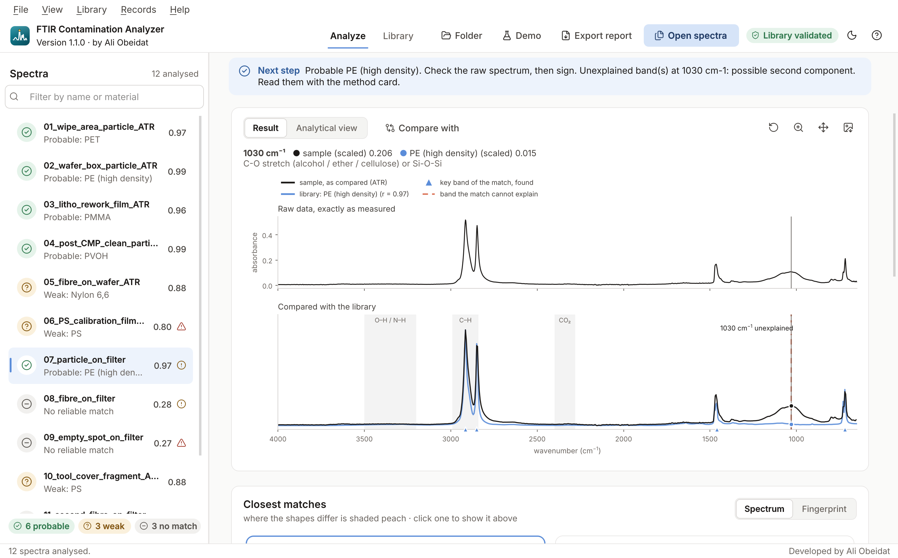

## Three ways to use it

| | What it is | Start it with |
| --- | --- | --- |
| **The app** | A desktop window: open or drop files, click through the results | `run_analyzer.bat` (Windows) or `python run_analyzer.py` |
| **As code** | One Python script with `# %%` cells, like a notebook: file dialog, results table, interactive figures, report | `FTIR_Analyzer.py` in VS Code, Spyder or Jupyter |
| **Batch** | No window at all: a folder in, a report out | `python -m ftir_analyzer --report OUT_FOLDER examples` |

All three use the same validated analysis and give the same results.

## How to run it (step by step)

### 1. Get the files

**Easiest:** download the repository as a ZIP:
**[FTIR-Contamination-Analyzer-main.zip](https://github.com/AObeidatCodes/FTIR-Contamination-Analyzer/archive/refs/heads/main.zip)**,
then right-click the ZIP → *Extract All…* and open the folder **FTIR-Contamination-Analyzer-main** inside it.

(On the GitHub page you can also click the green **Code** button → **Download ZIP**.)

### 2. Install Python (once)

Download **Python 3.13** from [python.org/downloads](https://www.python.org/downloads/). In the
installer, tick **"Add python.exe to PATH"**, then click *Install Now*.

### 3a. Start the app (Windows)

Double-click **`run_analyzer.bat`** in the **FTIR-Contamination-Analyzer-main** folder.

- The first start installs the packages the app needs (a few minutes, only once).
- If Windows shows *"Windows protected your PC"*, click **More info → Run anyway**. The file is a
  plain text script: right-click it → *Edit* to read every line.
- The app opens and asks you to choose spectrum files. To try it without your own data, click
  **Demo**.

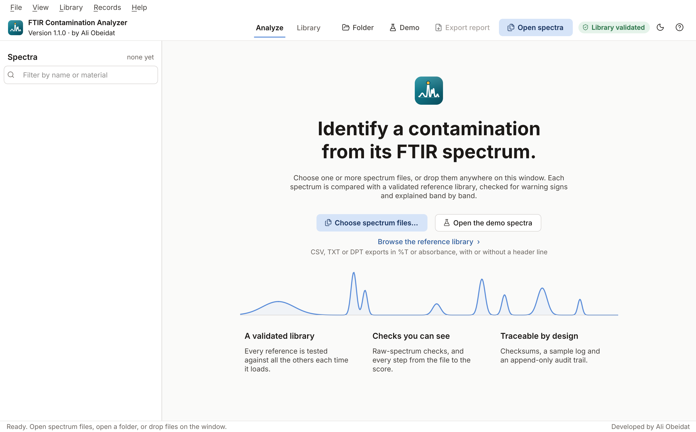

On a Mac or Linux, open the Terminal in the folder and type:

```
python3 -m pip install -r requirements.txt
python3 run_analyzer.py
```

### 3b. Or run it as code

1. Install the packages once: open a terminal in the folder and type
   `python -m pip install -r requirements.txt`
2. Open **`FTIR_Analyzer.py`** in VS Code (or Spyder, or Jupyter).
3. Click **Run Cell** above each `# %%` (or run the whole file). The settings are at the top:

```python
SETTINGS = {
    "files": [],                      # empty = a file dialog asks
    "use_demo_spectra": False,        # True = the twelve demo spectra
    "default_mode": None,             # "ATR" / "transmission" for files that do not say it; None = ask me
    "show_figures": True,             # interactive figure per spectrum
    "show_analytical_view": False,    # True = also every processing step
    "write_report": True,
    "open_report": True,
    "report_folder": "reports",
    "add_reference": None,            # a file to add to the in-house library (cell 8)
    "really_add": False,              # False = only show what adding it would do
}
```

### If something does not work

| What you see | What to do |
| --- | --- |
| "Python was not found" | Install Python (step 2) and tick *Add python.exe to PATH* |
| The packages cannot be installed | Check the internet connection. On a company laptop, IT may block installing packages: use a personal computer |
| The ZIP does not contain these files | Use the download link in step 1, then open the folder **FTIR-Contamination-Analyzer-main** inside it |
| The window does not open | Open a terminal in the folder and run `python run_analyzer.py`: the message explains what is missing |
| Figures do not appear inside VS Code / Jupyter | `python -m pip install nbformat`, then run again (or the figures open in the browser) |

## Using the app

| Action | How |
| --- | --- |
| Open spectrum files | **Open spectra** or `Ctrl+O` (CSV / TXT / DPT, %T or absorbance, with or without a header, any separator) |
| Open a whole folder | **Open folder** or `Ctrl+Shift+O` |
| Drag and drop | Drop files or a folder anywhere on the window |
| Try it | **Demo**: twelve real measurements with known answers ([`examples/README.md`](examples/README.md)) |
| See a result | Click a spectrum in the list. Type in the filter box to find a sample or a material |
| Trace the curves | Move the mouse over the spectrum: a dot on every curve, their values, and the band's name |
| Every processing step | Switch **Result → Analytical view** above the figure |
| Compare with another material | **Compare with** above the figure, or click one of the **Closest matches** under it |
| See how the shapes differ | **Closest matches**: the best four, side by side; *Spectrum* or *Fingerprint* |
| Zoom, pan, reset | `Ctrl` + mouse wheel zooms around the mouse, double-click resets, or use the buttons above the figure |
| Save a figure | The save button: PNG at 300 or 600 dpi, SVG or PDF (vector: any size). Saves the view on screen |
| Copy the result | `Ctrl+C` in the list (or right-click → **Copy the result**): verdict, score, flags, next step and the checksums as text, for a lab notebook, an e-mail or a ticket |
| Write the report | **Export report** or `Ctrl+E`: choose the folder, give your name and, if you like, sign it (decision, comment). `report.html` + `report.xlsx` + `report.csv`, a row per spectrum in the audit log, and a row in the signature log when signed |
| Browse the library | **Library** in the middle of the toolbar, or `Ctrl+2` (`Ctrl+1` back to Analyze). Click a card for details |
| More references | **Library → Open Specy…**: download or import; then switch **Fab essentials / Extended** |
| Add a reference | **Add to library…** on a result that is not *probable*, or **Library → Add a reference…** (`Ctrl+N`) |
| Light / dark | The moon / sun button or `Ctrl+T`. **View → Reduce motion** switches the animations off |
| Records | **Records** menu: sample log, audit log, signatures, each as a formatted Excel copy. **Library** menu: the library change log |
| Help | `F1` (how it works), **Help → About** |

When a file does not say how it was measured (ATR or transmission), the program asks once, then saves
the answer in the sample log with your user name and the date. Nothing is written into the raw files.

Everything is compared in the library's look (ATR): a transmission spectrum is multiplied by
1000 / wavenumber, whether it is a sample, an in-house reference or an Open Specy reference, so ATR
and transmission meet in the middle. **Don't know** is not a dead end: the spectrum is read both ways
and the reading that fits better is used and named ("compared as ATR: the better fit", with both
scores). Tested on the demo spectra whose mode is known, this picks the right mode every time the two
readings differ, and changes no verdict. When a mode *is* given but the other one fits clearly better
(by 0.05 or more), the result gets the flag **mode doubt**, e.g. the PE particle (07) entered as
transmission: "it fits clearly better as ATR (r 0.97 against 0.81)".

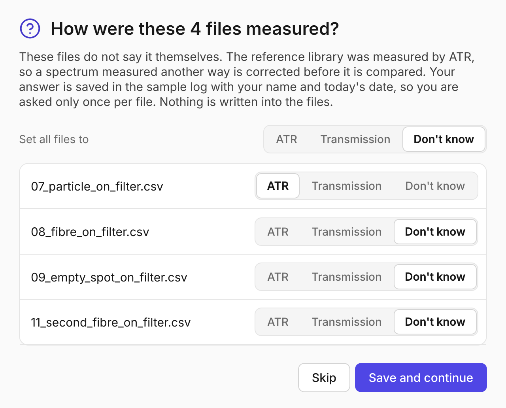

### Analytical view

Shows the work behind every result, one panel per step, all sharing the wavenumber axis, with a
sentence under the figure saying what each step did:

1. **Raw data**, exactly as measured (%T or absorbance)
2. **Absorbance**: A = −log₁₀(T / 100), so bands point up and scale with the amount
3. **Measuring-mode correction** on the common 5 cm⁻¹ grid (before in grey, after in ink)
4. **Derivative fingerprint** of the sample against the best library material: the two curves the
   Pearson r is calculated from (the program checks that this reproduces the score exactly)
5. **Checks**: the raw absorbance with its baseline, and the ruler line of every check zone (C–H,
   O–H / N–H, CO₂) with the measured height

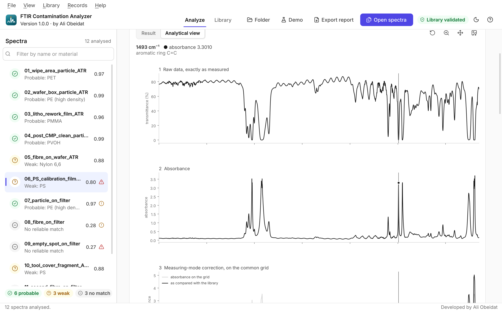

**Why can a CO₂ band point down in absorbance?** Absorbance is always calculated relative to the
background measurement: A = −log₁₀(I<sub>sample</sub> / I<sub>background</sub>). If there was less CO₂
in the air during the sample scan than during the background scan, more light reaches the detector at
2350 cm⁻¹ and the band comes out negative. The band depends on the air, not on the sample, which is
exactly how an artefact behaves. The app says which way it points and why, as in the empty-spot
example:

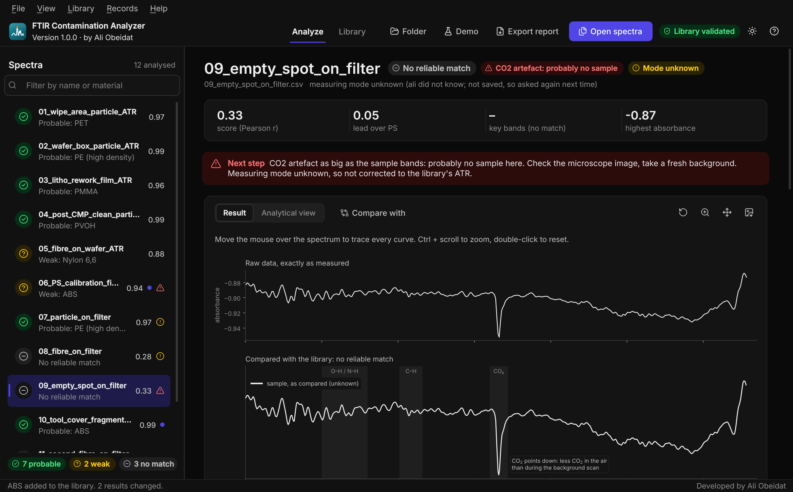

### Closest matches

Under the figure, the best four library materials are drawn next to each other, each over the
sample. The peach wash is the area between the two curves: where the shapes do not agree. The best
match should have almost none; the others show exactly where they fail. **Fingerprint** shows the two
derivative fingerprints the score is calculated from (the CO₂ region, which the score leaves out, is
greyed). Move the mouse over a chart to read both values; click one to draw it in the big figure.

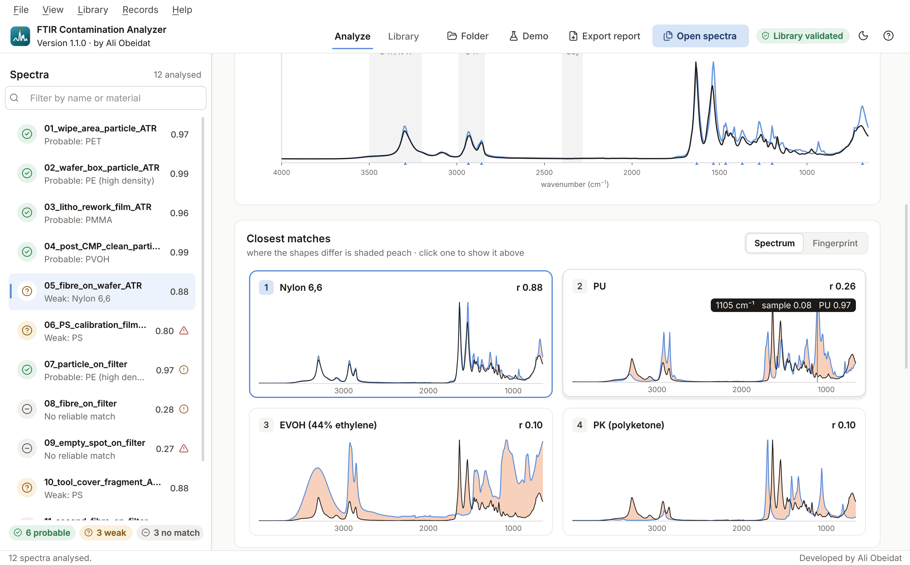

## The reference library

**Library** (`Ctrl+2`) shows every reference as a card: its spectrum, its name, its fab category and
where it came from. The categories on the left filter the cards; the search field finds a material,
a category or a source. The banner on top shows the library's validation: each reference is searched
for with itself removed, and the best *wrong* match (PET → PBT, r = 0.90) must stay below 0.95.

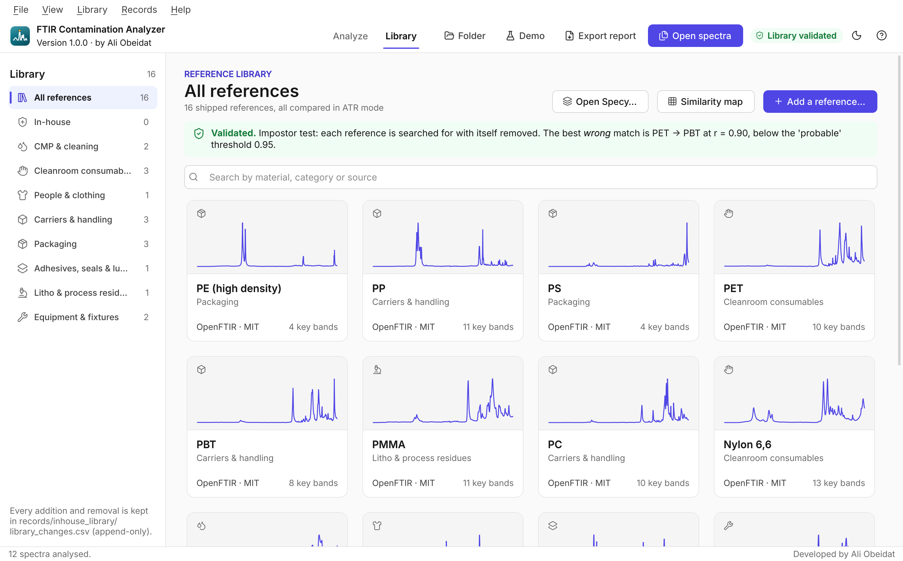

Click a card for the details: the spectrum (move the mouse over it to read the wavenumber, the value
and the band), its key bands, where it can come from in a fab, the five most similar references on
the same scale as the verdict thresholds, and its provenance. With a spectrum selected on the
Analyze page it is drawn on top, and **Compare with** shows the two side by side in the main figure.

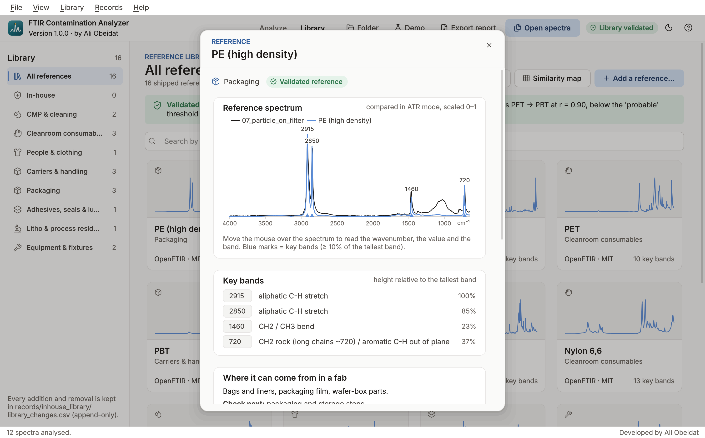

**Similarity map** shows every reference against every other one, each pair once (the lower half of
the table). Almost white = clearly different, soft coral = similar; a red frame would mark a pair at or
above 0.95 (two references the program could not tell apart), the dashed frame marks the closest pair.
The cells follow the size of the window. The same data is listed as a table of the closest pairs.

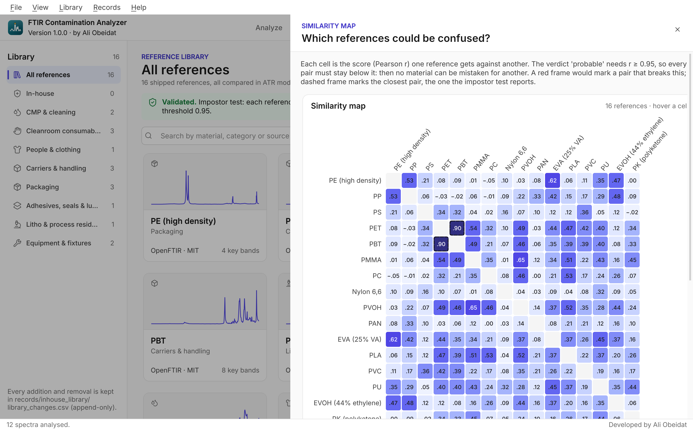

### Adding a reference: try it with the demo files

The demo shows the whole idea in five minutes: a sample that the library does not know, the
reference that teaches it, and the guard that stops a reference from breaking the library.
[`examples/CHECK_IT_YOURSELF.md`](examples/CHECK_IT_YOURSELF.md) is the same as a checklist to run
yourself, with every number you should see, plus a second example: the Nylon 6 fibre (05) goes from
*weak Nylon 6,6* (r 0.88) to **probable Nylon 6** (r 0.96) once a Nylon 6 reference from a fibre
reference collection is added, and only to *weak* if that reference is entered with the wrong mode.

1. **Open the demo spectra.** `10_tool_cover_fragment_ATR` is a fragment of an equipment cover made
   of ABS. ABS is not in the shipped library, so the best the program can say is **weak PS**
   (r 0.88): similar, not proven.

   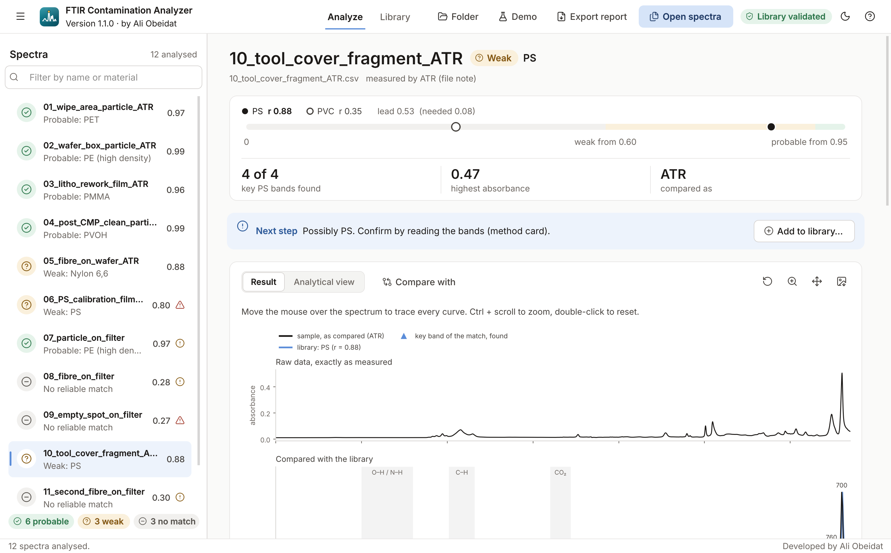

2. **Library → Add a reference… → A file**, and choose
   `examples/library_demo/ABS_reference_known_part.csv` (ABS measured on a known part). The file's
   header lines fill in the form: name, category, where it comes from in a fab, what to check next,
   and how its identity was confirmed. A few seconds later the validation is ready, *before* anything
   is saved:
   - most similar existing reference: PS at r 0.88 (below 0.95: clearly different)
   - impostor test: 0.90 now, 0.90 with ABS (still valid)
   - your spectra on screen: 2 of 12 would change, among them `10_tool_cover_fragment_ATR`:
     *weak PS* → **probable ABS**

   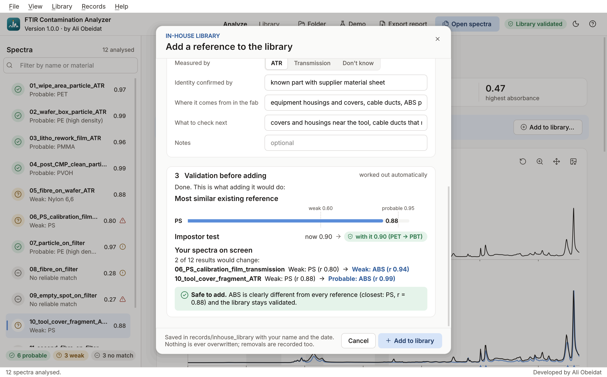

3. **Add to library.** The library is loaded again, validated again, and every spectrum is analysed
   again. The results that changed glow for a moment and keep a small blue dot.
   `10_tool_cover_fragment_ATR` is now **probable ABS (r 0.99)**, with all 7 key ABS bands found,
   and the fab sources entered with the reference.

   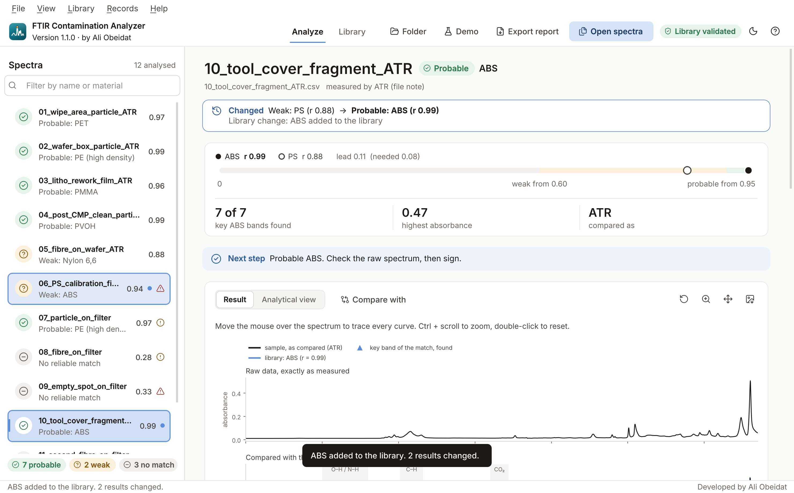

4. **Try to add `SAN_reference_cover_sample.csv`** the same way. SAN is chemically almost the same as
   ABS (r 0.98 against it). The program shows that a wrong *probable* would become possible and does
   **not** let it be added:

   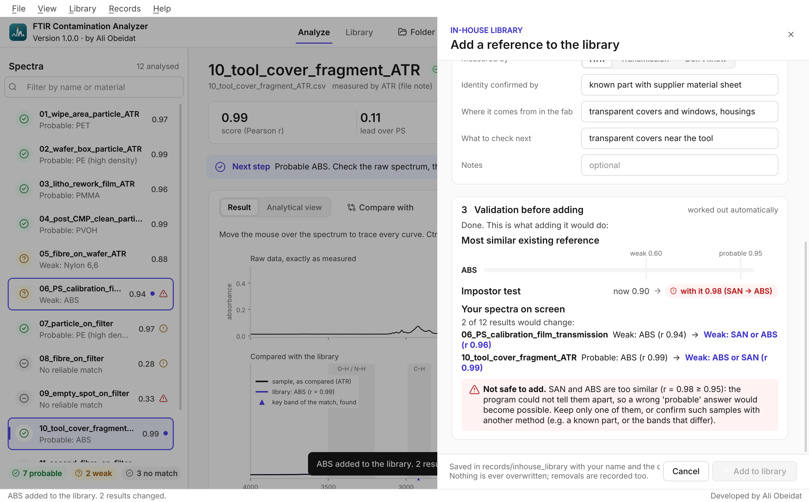

5. **The same works from a result.** Select `08_fibre_on_filter` (no reliable match, an organic not in
   the library), click **Add to library…**, name it *Cellulose acetate (fibre)* and say how it was
   identified (e.g. *band reading: acetate C=O 1740, C–O 1230*). `11_second_fibre_on_filter`, a
   second fibre from the same filter, becomes **probable**.

In-house references have their own category and a green cover. To take one out again, open its card
and choose **Remove from the library…** with a reason: it leaves the library, but its file and both
entries stay in `records/inhouse_library/library_changes.csv` (nothing is ever deleted).

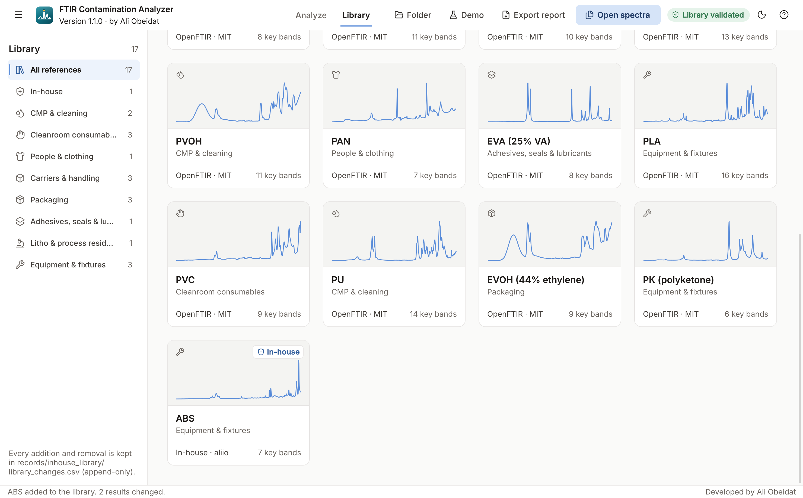

### More references: Open Specy (extended mode)

The shipped library holds 16 well-validated polymer references. For samples outside it, **Library →
Open Specy…** adds references from the Open Specy library (Cowger et al. 2021, CC BY 4.0):

1. **Download from Open Specy** gets the *medoid nobaseline* library (baseline-corrected absorbance)
   on your computer, from where Open Specy's own R package gets it
   (`https://d2jrxerjcsjhs7.cloudfront.net/medoid_nobaseline.rds`), or from the older copy on osf.io.
   Or **Import a library file…** if you downloaded it yourself (`.rds`). Open Specy's current file
   holds one library per kind of spectrum (FTIR, Raman, NIR); the FTIR one is used. Its FTIR range
   is cut to 800–2200 and 2420–3200 cm⁻¹ (no CO₂ region): the gap stays empty, nothing is drawn across
   it. The *derivative* library is refused: processed derivative spectra cannot be compared with
   absorbance.
2. Only FTIR spectra of materials a fab is likely to see are kept (gloves, wipes, seals,
   fluoropolymers, silicones, resins and adhesives, fibres, silica and other minerals), at most three
   per material. Raman spectra and environmental samples are left out.
3. Every spectrum is compared with every reference. One that could be confused with a *different*
   material (r ≥ 0.95) is left out and listed in the report, so the extended library still passes
   the impostor test. References of the *same* material (polyethylene from Open Specy and PE from the
   shipped library) are not rivals: the verdict's lead is measured to the next different material.
4. The result is kept in `records/openspecy/` with an import report. Switch between **Fab
   essentials** and **Extended** on the Library page; the open results are analysed again at once.

The import was tested with a file in Open Specy's older format (`tests/data/openspecy_sample.rds`),
with one laid out like the current file (FTIR / Raman / NIR parts, R classes, the cut-out CO₂ region)
and with a deliberately untidy one (names with `#`, wavenumbers from high to low, empty and short spectra,
missing metadata): an odd spectrum is counted in the report and left out, it never stops the import.
The download needs internet access to Open Specy's storage on your computer. If an import fails, the
full details are in `records/error_log.txt`.

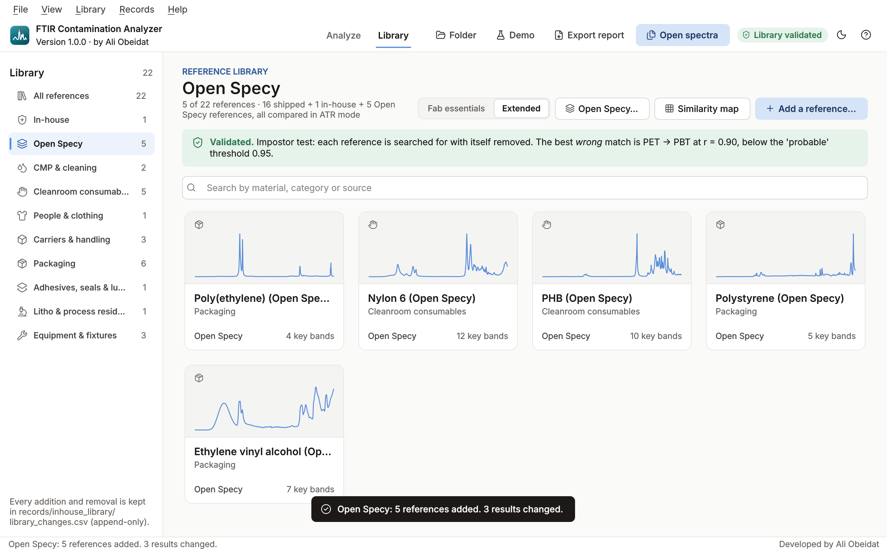

*The screenshot shows the 5 references kept from the small test file, not the full Open Specy library.*

### The report

One self-contained HTML page that opens in any browser, works offline and prints to PDF. The figures
are interactive: hover to read every value and the band name, zoom, pan, and save a 4× PNG with the
camera button. Each spectrum has a closed **Analytical view** section with every step, in words and
as an interactive figure. The **Reference library** section lists every in-house reference that was
used, with who added it, when, how its identity was confirmed and its checksum.

- **The score strip.** Every spectrum's score r is drawn on a 0–1 scale coloured by the verdict rule
  (grey: no reliable match, amber: weak from 0.60, green: probable from 0.95). The filled dot is the
  best material, the hollow dot the next *different* material, so the lead the rule asks for (0.08)
  is the distance between the two dots. The summary table has a small copy of it in every row.
- **A bar that stays in view** with the parts of the report and the two things a reviewer checks
  first: is the library validated, is the report signed.
- **Every screen and paper.** It follows the computer's light or dark setting (the figures too), fits
  a phone without scrolling sideways, and prints on white paper with every closed section opened, so
  the PDF keeps the file paths and checksums.

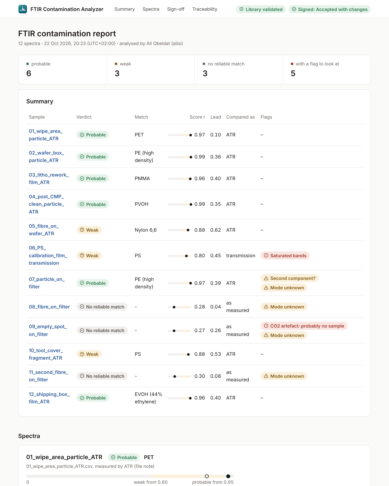

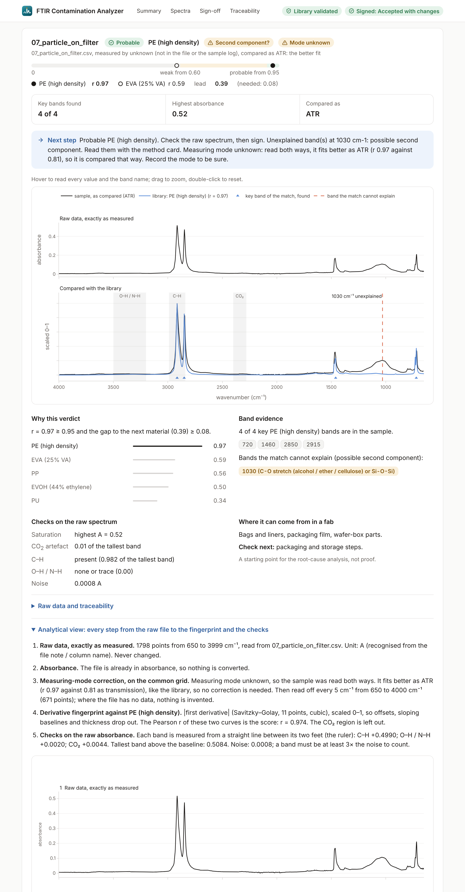

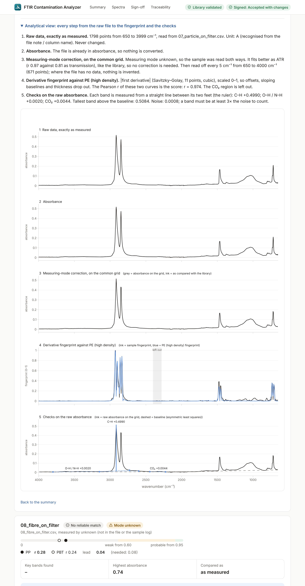

### Without a window (batch / automation)

```
python -m ftir_analyzer --report OUT_FOLDER examples            # analyse a folder, write the report
python -m ftir_analyzer --report OUT_FOLDER *.csv --mode ATR     # mode for files that do not state it
python -m ftir_analyzer --version
```

## How it works

| Step | What happens | Why |
| --- | --- | --- |
| 1. Read | The file is read exactly as measured; the arrays are made read-only and the SHA-256 is recorded | The raw data can never change by accident and the report can be traced to the exact file |
| 2. Absorbance | %T → A = −log₁₀(T), on a copy | Band heights are proportional to the amount (Beer–Lambert) |
| 3. Mode correction | Transmission spectra are given the "ATR look" (× 1000 / ν̃): samples and references alike. Mode unknown: both readings are compared and the better fit is used | The library was measured by ATR, where the light reaches less deep at high wavenumber |
| 4. Common grid | 650–4000 cm⁻¹ in 5 cm⁻¹ steps; no data is invented outside the measured range | Sample and reference are compared point by point |
| 5. Fingerprint | \|Savitzky–Golay first derivative\| (window 11, order 3), scaled 0–1 | Offsets, sloping baselines and sample thickness drop out |
| 6. Search | Pearson r against every reference, CO₂ region 2280–2400 cm⁻¹ left out | Measures whether the shapes go up and down together |
| 7. Verdict | **probable**: r ≥ 0.95 and ≥ 0.08 ahead of the next material · **weak**: r ≥ 0.60 · else **no reliable match** | The impostor test shows that a wrong material reaches at most 0.90 in this library (PET ↔ PBT) |
| 8. Checks | Ruler method (height above a straight line between the band's feet), noise = robust SD in the worst quiet window | Judges small bands fairly on a sloping background |
| 9. Evidence | Key bands found or missing; unexplained bands (≥ 15 % where the reference absorbs < ⅓ as strongly) | Explains *why*, and finds mixtures |

Every rule and threshold lives in [`ftir_analyzer/config.py`](ftir_analyzer/config.py), with the reason for its value.

## Project layout

```
├── run_analyzer.py / run_analyzer.bat   start the app
├── FTIR_Analyzer.py                     the same analysis as one script, run as code (# %% cells)
├── ftir_analyzer/                       the program
│   ├── config.py        every setting, with its reason
│   ├── spectrum_io.py   read files exactly as measured (read-only, checksummed)
│   ├── processing.py    absorbance, grid, baseline, fingerprint, ATR correction
│   ├── peaks.py         real peaks and their names from the band table
│   ├── library.py       reference library (shipped + in-house), search, impostor test, validation of
│   │                    a new reference, similarity map
│   ├── inhouse.py       the in-house library: add / remove with an append-only change log, and the
│   │                    preview of what adding a reference would change
│   ├── checks.py        saturation, CO2 (with its direction), C-H, O-H / N-H, noise, ruler lines
│   ├── evidence.py      key bands found / missing / unexplained, fab sources
│   ├── openspecy.py     the optional Open Specy references: download, import, choose, validate
│   ├── analysis.py      the whole pipeline for one spectrum -> one Result
│   ├── analytical.py    every intermediate step of one analysis (the analytical view)
│   ├── records.py       sample log, audit log and signatures (append-only), readable times
│   ├── log_views.py     the records and the report's table as formatted Excel sheets
│   ├── export_view.py   the "Export report" sheet: folder, name, review and signature
│   ├── plots.py         figures for the app and saved images (matplotlib)
│   ├── interactive.py   interactive figures for the report and the script (Plotly)
│   ├── report.py        HTML, Excel and CSV report
│   ├── theme.py         design system: colours (light and dark), fonts, sizes, animation times
│   ├── motion.py        animation, smooth scrolling, cards, segmented control, sheets, toasts, a
│   │                    row that wraps
│   ├── widgets.py       building blocks of the window: pills, score bars, list, plot, welcome screen
│   ├── compare_view.py  the closest matches, side by side
│   ├── library_view.py  the Library page: album, details, similarity map, adding a reference
│   ├── jobs.py          background work (the window never freezes)
│   ├── gui.py           the desktop app (Qt)
│   ├── data/            reference library (index + spectra), band table, fab sources
│   └── assets/          logo, fonts (Inter, IBM Plex Mono), icons (Lucide)
├── examples/            demo spectra with known answers; library_demo/ for adding a reference;
│                        CHECK_IT_YOURSELF.md, a walkthrough with the numbers to expect
├── records/             sample log, audit log, signatures, in-house library (created when first needed)
├── tests/               known-answer, library, Open Specy, window, layout and script tests (pytest)
└── docs/                screenshots
```

## Tests

```
pip install pytest
python -m pytest
```

102 tests. 46 cover the analysis: file reading (read-only data, headerless tab-separated files, unit
recognition, clear errors), processing, the verdict rule, the impostor test, the known answer for
every demo spectrum, the second-component, empty-spot and saturation detection, the CO₂ direction,
the analytical view (each step reproduced, the score recalculated from step 4), the interactive
figures, the append-only records, and ATR / transmission: a transmission sample meets the ATR
library with the same score, an ATR sample meets a transmission reference (r 1.00, and why the
reference's mode matters), an unknown mode is worked out from the better fit for every demo whose mode
is known, a wrong mode is flagged, and nothing is corrected when neither reading fits; a signed report
and its row in the signature log (pointing at that exact file), readable times, and the records as
formatted Excel sheets (the record itself untouched). 8 cover the
in-house library: provenance of every reference, the similarity map, adding ABS makes demo 10
*probable ABS*, SAN after ABS is caught before it is added, the Nylon 6 walkthrough with its numbers,
adding a result as a reference, removing keeps the history, names must be new. 14 cover the Open
Specy references: material groups, only fab-relevant FTIR spectra kept, confusable spectra left out,
a valid extended library, a second reference of the same material does not weaken a verdict, the
derivative library refused, the download (from where Open Specy keeps it, then the older copy), names
with a `#`, a deliberately untidy library file, the current FTIR / Raman / NIR file (its FTIR part
used, a file without one refused), no data made up across a cut-out region, and transmission
references put into the ATR look. 25 start the window without a screen and use it,
including the animations finishing in the right state, the bars growing in the sheets, the closest
matches, the Library page, adding / refusing / removing a reference, switching to the extended library
copying a result, new badges already in the picture a transition plays, and the close button on a
sheet from its first frame, a change shown where it is seen, and exporting a signed report. 7 check
the layout at 960 × 560, 1280 × 720 and 1920 × 1080: no page scrolls
sideways or is cut off at the side, no text is cut off, nothing overlaps, every sheet (an in-house
reference with all its buttons and the export sheet included) sits in the middle and the welcome page fits a
laptop window without scrolling. 2 run
`FTIR_Analyzer.py` from start to end.

## Design

Minimal and modern, following a design guide for clean interfaces: warm greys, ONE accent colour (a
soft powder blue), an 8 px spacing grid, white cards with a 1 px border (a soft shadow only while a
card is lifted under the mouse), no gradients, and text of 14 px and up.

- **Soft colours, still readable.** Buttons and badges are pastel tints with dark text (7.3 : 1 or
  more), the status colours are pastel too (green = probable, amber = weak, grey = no reliable match,
  red = do not trust as it is), and a colour never appears without its icon and its word. Lines, bars
  and focus rings use a deeper step of the same blue, so they stand out from every background (3 : 1
  or more). All text meets WCAG (≥ 4.5 : 1; body text ≥ 9 : 1), worked out for both themes.
- **Charts checked, not guessed.** Sample = ink, library reference = soft blue, unexplained band = soft
  coral, where two shapes differ = a peach wash. The blue and the coral pass the colour-blind check
  (`validate_palette`) on the light and on the dark background. The similarity map is one warm hue,
  with dark text on every step (6 : 1 or more). Peak labels have a halo, so a line never hides them.
- **Typeface.** Inter, embedded in the app and in the report, so it looks the same on every computer;
  IBM Plex Mono for checksums and paths (embedded too).
- **Fits any window.** On a narrow window the toolbar shows icons only, the facts wrap into two rows,
  the cards stack, the Library page's buttons move under its title and long names are shortened
  with … (the full text is in the tooltip). On a low window the welcome page leaves out its
  illustration. Nothing scrolls sideways.
- **Sheets.** Details, the similarity map, adding a reference and Open Specy open as a card in the
  middle of the dimmed window, sized to their content; `Esc` or a click outside closes them, and the
  keyboard focus goes back to where it was.
- **Smooth motion, by construction.** Moving real widgets is slow (Qt would draw every card, list and
  figure again on every frame), so every transition is a flip-book: take a picture of the old state, do
  all the slow work at once (fill the page, draw the figure), take a picture of the new state, then
  animate only the two pictures on one opaque layer. While it plays, the widgets underneath do not paint
  at all and Python's garbage collector waits (a collection can take two or three frames). A sheet is
  photographed once with its shadow and only fades in and rises 16 px: a short distance looks smooth
  even where the screen and Qt are not in step.
- **Nothing pops in.** Qt shows a widget that was just put into a layout a moment later, and styles it
  a moment after that. Before the picture of the new state is taken, all of it is done, so the badges,
  flags and the close button are already in the picture and the real page that replaces it at the end
  looks exactly the same (they used to appear only when the motion ended, and that work made the first
  frame late).
- **Every control answers.** Hover, pressed, focus and disabled states on every button, the filled
  ones included (a slightly deeper tint while pressed).
- **Motion with a purpose.** Short (150–280 ms), easing out (fast start, gentle stop), never bouncing;
  the most frequent action (clicking through samples) gets the quickest one. The curves and timings
  follow Material Design, Fluent, Emil Kowalski's and Rauno Freiberg's guidelines. **View → Reduce
  motion** switches it off, and it starts off if Windows' "Show animations" is off.
- **Keyboard and focus.** Every action has a shortcut, the controls can be reached with Tab and show
  a focus ring, `Esc` closes a sheet.
- **The window never freezes.** Loading and validating the library, analysing, checking a new
  reference, importing Open Specy and writing the report run in the background. If something goes
  wrong, the message has the details and they are kept in `records/error_log.txt`.

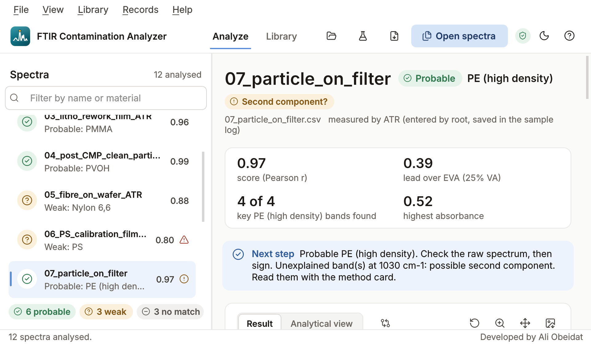

### Measured

**Layout.** Every page and sheet (welcome, result, closest matches, analytical view, library,
similarity map, Open Specy, reference details, adding a reference) was opened at 960 × 560, 1093 × 614,
1280 × 720, 1536 × 864 and 1920 × 1080 at 100 % display scaling, and at the sizes a 1366 × 768,
1920 × 1080 and 2560 × 1600 screen give at 125 % and 150 %. Each visible element was checked for
running off its container, cut text, too narrow buttons, overlapping neighbours, sideways scrolling
and an off-centre sheet: **0 problems in 111 screens** (the previous version: 61 problems in 26
screens at just two sizes, among them the similarity table running off the side).

**Motion** (window 1280 × 720 at 150 %, the frame times while it moves; a screen refreshes every
16.7 ms):

| Transition | Waits before it moves | Typical frame | Slowest frame | Painting one frame |
| --- | --- | --- | --- | --- |
| Click another sample | 0.13–0.21 s (drawing the figure) | 16 ms | 17 ms (was 24–28 ms) | 3–4 ms |
| Analyze ↔ Library | 0.04–0.07 s | 16 ms | 17 ms | 7–8 ms |
| Open / close a sheet | 0.02–0.10 s | 16 ms | 19–27 ms (one frame) | 3–9 ms |
| Light ↔ dark | 0.41–0.44 s (restyling every widget) | 16 ms | 17 ms | 7 ms |

At 100 % display scaling every transition stays at 16–18 ms per frame.

## Limits

- The shipped library holds 16 polymer references. A production lab would add its own in-house
  references (pads, brushes, wipes, gloves, resists, greases) measured on its own instrument; the
  Library page is built for exactly that, and checks every addition.
- Two materials that are chemically almost the same (like ABS and SAN) cannot both be references:
  the program cannot tell them apart from the spectrum alone, and says so.
- Open Specy references are measured on many instruments, by ATR and transmission (put into the ATR
  look when Open Specy says which; used as measured when it does not); they widen the coverage, but a
  match to one should be confirmed with the band evidence and, where possible, an in-house reference.
- The ATR correction is the standard one (penetration depth ∝ 1 / wavenumber). The small shifts of
  very strong bands in ATR (a few cm⁻¹, from the change of refractive index across the band) are not
  modelled; the derivative fingerprint and the band tolerance (15 cm⁻¹) absorb them.
- The verdict is a suggestion. A person reviews the raw spectrum and signs the report.
- Mixtures are flagged (unexplained bands), not yet separated by spectral subtraction.

## Data

Reference and demo spectra come from open sources: the 16 shipped references are raw ATR spectra
from OpenFTIR (MIT). The Open Specy references are not shipped: they are downloaded or imported on
your computer (CC BY 4.0) and only their *nobaseline* (absorbance) library is used. See
[`ftir_analyzer/data/README.md`](ftir_analyzer/data/README.md) and
[`THIRD_PARTY_NOTICES.md`](THIRD_PARTY_NOTICES.md).

## Author

**Ali Obeidat**. Design, implementation and validation. Licensed under the MIT License
(see [`LICENSE`](LICENSE)). The font, icons and spectra are open-source third-party material,
credited in [`THIRD_PARTY_NOTICES.md`](THIRD_PARTY_NOTICES.md).
