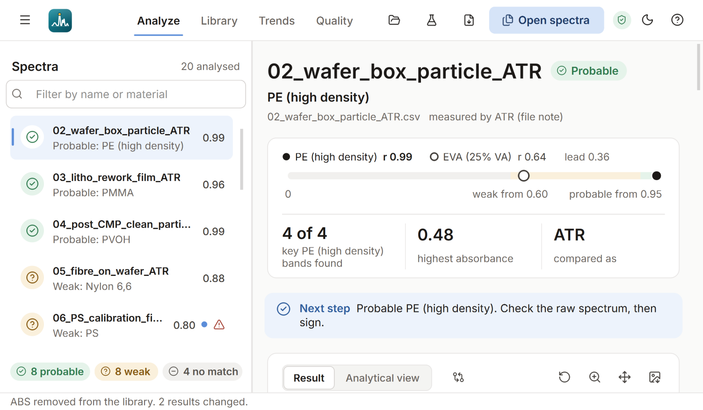

# Technical notes

How the app is tested, the design choices behind it, and how fast it is.

## Tests

```
pip install pytest
python -m pytest
```

345 tests. Those for the analysis cover file reading (read-only data, headerless tab-separated files, unit
recognition, clear errors), processing, the verdict rule, the impostor test, the known answer for
every demo spectrum, the second-component, empty-spot and saturation detection, the CO₂ direction,
the analytical view (each step reproduced, the score recalculated from step 4), the interactive
figures, the append-only records, and ATR / transmission: a transmission sample meets the ATR
library with the same score, an ATR sample meets a transmission reference (r 1.00, and why the
reference's mode matters), an unknown mode is worked out from the better fit for every demo whose mode
is known, a wrong mode is flagged, and nothing is corrected when neither reading fits; a signed report
and its row in the signature log (pointing at that exact file), readable times, and the records as
formatted Excel sheets (the record itself untouched). 8 cover the
in-house library: provenance of every reference, the similarity map, adding ABS makes demo 10
*probable ABS*, SAN after ABS is caught before it is added, the Nylon 6 walkthrough with its numbers,
adding a result as a reference, removing keeps the history, names must be new. 14 cover the Open
Specy references: material groups, only fab-relevant FTIR spectra kept, confusable spectra left out,
a valid extended library, a second reference of the same material does not weaken a verdict, the
derivative library refused, the download (from where Open Specy keeps it, then the older copy), names
with a `#`, a deliberately untidy library file, the current FTIR / Raman / NIR file (its FTIR part
used, a file without one refused), no data made up across a cut-out region, and transmission
references put into the ATR look. 25 start the window without a screen and use it,
including the animations finishing in the right state, the bars growing in the sheets, the closest
matches, the Library page, adding / refusing / removing a reference, switching to the extended library
copying a result, new badges already in the picture a transition plays, and the close button on a
sheet from its first frame, a change shown where it is seen, and exporting a signed report. 7 check
the layout at 960 × 560, 1280 × 720 and 1920 × 1080: no page scrolls
sideways or is cut off at the side, no text is cut off, nothing overlaps, every sheet (an in-house
reference with all its buttons and the export sheet included) sits in the middle and the welcome page fits a
laptop window without scrolling. 2 run
`FTIR_Analyzer.py` from start to end.

## Design

Minimal and modern, following a design guide for clean interfaces: warm greys, ONE accent colour (a
soft powder blue), an 8 px spacing grid, white cards with a 1 px border (a soft shadow only while a
card is lifted under the mouse), no gradients, and text of 14 px and up.

- **One picture for the verdict, in the app and in the report.** The score strip shows the score r
  (filled dot) and the next different material (hollow dot) on a track coloured by the verdict rule:
  grey below 0.60, amber from 0.60 (weak), green from 0.95 (probable). The lead is the distance
  between the two dots. When a spectrum is selected the dots slide to their scores.
- **Nothing decorative.** No small upper-case labels above headings and no icon-topped cards; the
  figure's legend sits above the panels, so it never covers a curve or a shaded zone.
- **Soft colours, still readable.** Buttons and badges are pastel tints with dark text (7.3 : 1 or
  more), the status colours are pastel too (green = probable, amber = weak, grey = no reliable match,
  red = do not trust as it is), and a colour never appears without its icon and its word. Lines, bars
  and focus rings use a deeper step of the same blue, so they stand out from every background (3 : 1
  or more). All text meets WCAG (≥ 4.5 : 1; body text ≥ 9 : 1), worked out for both themes.
- **Charts checked, not guessed.** Sample = ink, library reference = soft blue, unexplained band = soft
  coral, where two shapes differ = a peach wash. The blue and the coral pass the colour-blind check
  (`validate_palette`) on the light and on the dark background. The similarity map is one warm hue,
  with dark text on every step (6 : 1 or more). Peak labels have a halo, so a line never hides them.
- **Typeface.** Inter, embedded in the app and in the report, so it looks the same on every computer;
  IBM Plex Mono for checksums and paths (embedded too).
- **Fits any window.** On a narrow window the toolbar shows icons only, the facts stack,
  the cards stack, the Library page's buttons move under its title and long names are shortened
  with … (the full text is in the tooltip). On a low window the welcome page leaves out its
  illustration. Nothing scrolls sideways.
- **Sheets.** Details, the similarity map, adding a reference and Open Specy open as a card in the
  middle of the dimmed window, sized to their content; `Esc` or a click outside closes them, and the
  keyboard focus goes back to where it was.
- **Smooth motion, by construction.** Moving real widgets is slow (Qt would draw every card, list and
  figure again on every frame), so every transition is a flip-book: take a picture of the old state, do
  all the slow work at once (fill the page, draw the figure), take a picture of the new state, then
  animate only the two pictures on one opaque layer. While it plays, the widgets underneath do not paint
  at all and Python's garbage collector waits (a collection can take two or three frames). A sheet is
  photographed once with its shadow and only fades in and rises 16 px: a short distance looks smooth
  even where the screen and Qt are not in step.
- **Scrolling that glides.** A mouse-wheel notch moves a target; every frame (60 a second) the page
  covers the same share of the distance still to go, timed by the clock, so a late frame does not make
  it stutter (the same idea as Lenis in the report). The small charts on the result tiles and library
  cards are drawn once, in quiet moments just after a page appears, so none is drawn for the first time
  while it scrolls into view. Touchpads and `Ctrl` + wheel work as before; with Windows' "show
  animations" off, the wheel scrolls in plain steps.
- **Nothing pops in.** Qt shows a widget that was just put into a layout a moment later, and styles it
  a moment after that. Before the picture of the new state is taken, all of it is done, so the badges,
  flags and the close button are already in the picture and the real page that replaces it at the end
  looks exactly the same (they used to appear only when the motion ended, and that work made the first
  frame late).
- **Every control answers.** Hover, pressed, focus and disabled states on every button, the filled
  ones included (a slightly deeper tint while pressed).
- **Motion with a purpose.** Short (150–280 ms), easing out (fast start, gentle stop), never bouncing;
  the most frequent action (clicking through samples) gets the quickest one. The curves and timings
  follow Material Design, Fluent, Emil Kowalski's and Rauno Freiberg's guidelines. **View → Reduce
  motion** switches it off, and it starts off if Windows' "Show animations" is off.
- **Keyboard and focus.** Every action has a shortcut, the controls can be reached with Tab and show
  a focus ring, `Esc` closes a sheet.
- **The window never freezes.** Loading and checking the library, analysing, checking a new
  reference, importing Open Specy and writing the report run in the background. If something goes
  wrong, the message has the details and they are kept in `records/error_log.txt`.



### Measured

**Layout.** Every page and sheet (welcome, result, closest matches, analytical view, library,
similarity map, Open Specy, reference details, adding a reference) was opened at 960 × 560, 1093 × 614,
1280 × 720, 1536 × 864 and 1920 × 1080 at 100 % display scaling, and at the sizes a 1366 × 768,
1920 × 1080 and 2560 × 1600 screen give at 125 % and 150 %. Each visible element was checked for
running off its container, cut text, too narrow buttons, overlapping neighbours, sideways scrolling
and an off-centre sheet: **0 problems in 111 screens** (the previous version: 61 problems in 26
screens at just two sizes, among them the similarity table running off the side).

**Motion** (window 1280 × 720 at 150 %, the frame times while it moves; a screen refreshes every
16.7 ms):

| Transition | Waits before it moves | Typical frame | Slowest frame | Painting one frame |
| --- | --- | --- | --- | --- |
| Click another sample | 0.13–0.21 s (drawing the figure) | 16 ms | 17 ms (was 24–28 ms) | 3–4 ms |
| Analyze ↔ Library | 0.04–0.07 s | 16 ms | 17 ms | 7–8 ms |
| Open / close a sheet | 0.02–0.10 s | 16 ms | 19–27 ms (one frame) | 3–9 ms |
| Light ↔ dark | 0.41–0.44 s (restyling every widget) | 16 ms | 17 ms | 7 ms |

At 100 % display scaling every transition stays at 16–18 ms per frame.
